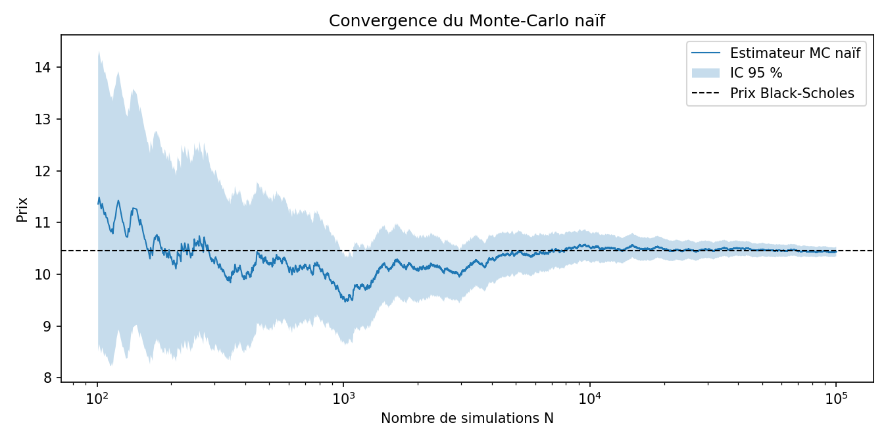
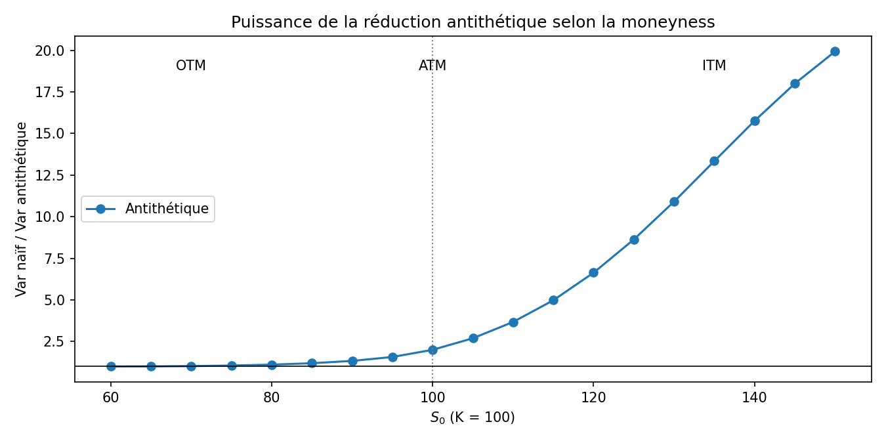
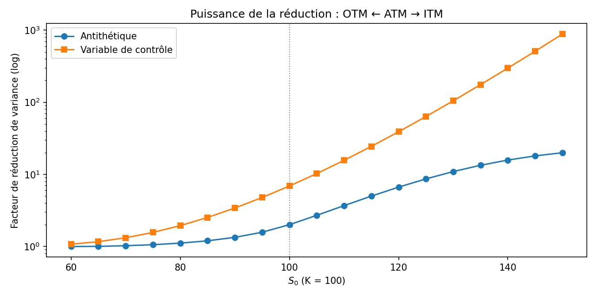
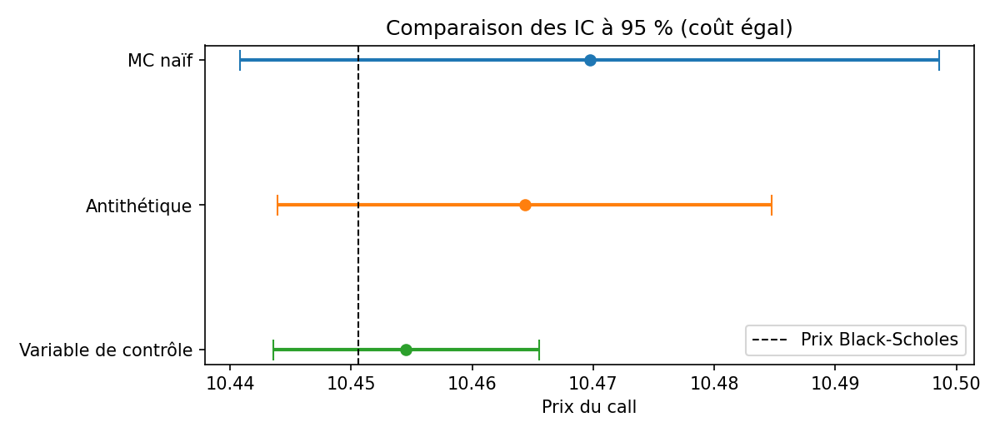

# Méthodes de Monte-Carlo et réduction de variance

*Pricing d'un call européen dans le modèle de Black-Scholes*

## Présentation du projet

**Problématique.** On cherche à estimer le prix d'un call européen

```math
C = \mathbb{E}\left[e^{-rT}(S_T - K)^+\right], \qquad S_T = S_0  e^{(r-\sigma^2/2)T + \sigma\sqrt{T} Z},\quad Z\sim\mathcal{N}(0,1).
```

Dans ce modèle le prix exact est donné par la formule de Black-Scholes, ce qui permet de mesurer la qualité des estimateurs Monte-Carlo. Pour des produits plus complexes, sans formule fermée, la simulation est souvent la seule méthode disponible. Il faut alors la rendre la plus précise possible pour un coût de calcul donné.

**Méthode de Monte-Carlo naïve.** On simule $`N`$ payoffs actualisés indépendants et on en prend la moyenne.

**Réduction de variance.** L'erreur de Monte-Carlo est en $`\sigma/\sqrt{N}`$ : pour la diviser par 10, il faut 100 fois plus de simulations. On cherche donc plutôt à **réduire $`\sigma`$**, avec deux méthodes :
- les **variables antithétiques** ;
- une **variable de contrôle**.

Paramètres de référence : $`S_0 = 100`$, $`K = 100`$, $`r = 5\%`$, $`\sigma = 20\%`$, $`T = 1`$ an. Prix exact : **10,4506**.

---

## 1. Méthode de Monte-Carlo naïve

**Loi forte des grands nombres.** Soit $`X = e^{-rT}(S_T-K)^+`$ et $`X_1,\dots,X_N`$ i.i.d. de même loi que $`X`$. Alors

```math
\hat{C}_N = \frac{1}{N}\sum_{i=1}^N X_i \xrightarrow[N\to\infty]{p.s.} \mathbb{E}[X] = C.
```

L'estimateur est sans biais et convergent.

**Estimation de l'erreur via le TCL.** Si $`\sigma_X^2 = \mathrm{Var}(X) \lt \infty`$,

```math
\sqrt{N} \frac{\hat{C}_N - C}{\sigma_X} \xrightarrow{\mathcal{L}} \mathcal{N}(0,1)
\quad\Longrightarrow\quad
IC_{95\%} = \left[\hat{C}_N \pm 1.96 \frac{\hat{\sigma}_N}{\sqrt N}\right].
```

**Nombre minimum de simulations pour un IC à 95 %.** Pour une demi-largeur au plus égale à $`\varepsilon`$ :

```math
N \ge \left(\frac{1.96 \sigma_X}{\varepsilon}\right)^2.
```

Avec $`\hat{\sigma}_X \approx 14.68`$ :

| Précision $`\varepsilon`$ | N minimum |
|---|---|
| ± 0,10 | 82 788 |
| ± 0,05 | 331 150 |
| ± 0,01 | 8 278 736 |

```python
def call_mc(S0, K, r, sigma, T, N=1_000_000, seed=0):
    rng = np.random.default_rng(seed)
    Z = rng.standard_normal(N)
    ST = S0 * np.exp((r - 0.5 * sigma**2) * T + sigma * np.sqrt(T) * Z)
    X = np.exp(-r * T) * np.maximum(ST - K, 0)
    price = X.mean()
    se = X.std(ddof=1) / np.sqrt(N)
    return price, (price - 1.96 * se, price + 1.96 * se)
```



---

## 2. Réduction de variance via la méthode antithétique

**Présentation de la méthode.** Si $`Z\sim\mathcal N(0,1)`$, alors $`-Z`$ suit la même loi. On simule donc les trajectoires **par paires** $`(Z, -Z)`$ et on utilise

```math
Y = \tfrac12\big(X^+ + X^-\big),\qquad \mathbb E[Y] = C \quad\text{(sans biais)}.
```

**Avantage par rapport au Monte-Carlo naïf.**

```math
\mathrm{Var}(Y) = \frac{\sigma_X^2}{2} \big(1 + \rho(X^+,X^-)\big).
```

À coût égal ($`2N`$ simulations), on gagne dès que $`\rho \lt 0`$. C'est le cas ici, car le payoff du call est une fonction monotone de $`Z`$. La méthode ne demande aucune information supplémentaire et réduit de moitié le nombre de tirages aléatoires.

```python
def call_mc_antithetique(S0, K, r, sigma, T, N=500_000, seed=0):
    rng = np.random.default_rng(seed)
    Z = rng.standard_normal(N)
    drift = (r - 0.5 * sigma**2) * T
    vol = sigma * np.sqrt(T)
    ST_plus = S0 * np.exp(drift + vol * Z)
    ST_moins = S0 * np.exp(drift - vol * Z)
    X_plus = np.exp(-r * T) * np.maximum(ST_plus - K, 0)
    X_moins = np.exp(-r * T) * np.maximum(ST_moins - K, 0)
    Y = 0.5 * (X_plus + X_moins)
    price = Y.mean()
    se = Y.std(ddof=1) / np.sqrt(N)
    return price, (price - 1.96 * se, price + 1.96 * se)
```

### Puissance de la réduction en fonction du prix du sous-jacent

On fait varier $`S_0`$ avec $`K = 100`$ fixé. Le facteur de réduction est $`\mathrm{Var}_{\text{naïf}} / \mathrm{Var}_{\text{antithétique}}`$, à coût égal.



| | Hors de la monnaie ($`S_0 = 70`$) | À la monnaie ($`S_0 = 100`$) | Dans la monnaie ($`S_0 = 130`$) |
|---|---|---|---|
| Facteur de réduction | 1,02 | 2,00 | 10,91 |

- **Hors de la monnaie** : $`X^+`$ et $`X^-`$ sont presque toujours nuls tous les deux. Leur corrélation est proche de 0, donc on ne gagne quasiment rien.
- **À la monnaie** : la variance est divisée par 2.
- **Dans la monnaie** : le payoff se comporte presque comme $`S_T - K`$, fonction quasi linéaire de $`Z`$. $`X^+`$ et $`X^-`$ sont alors fortement anti-corrélés, et le gain devient important.

---

## 3. Réduction de variance via une variable de contrôle

**Présentation de la méthode.** On utilise une variable $`Y`$ corrélée à $`X`$ et d'**espérance connue** : $`Y = e^{-rT}S_T`$, avec $`\mathbb E[Y] = S_0`$ (le sous-jacent actualisé est une martingale sous la probabilité risque-neutre). Pour tout $`\beta`$,

```math
W_\beta = X - \beta (Y - S_0),\qquad \mathbb E[W_\beta] = C.
```

**Calcul de $`\beta^*`$.**

```math
\mathrm{Var}(W_\beta) = \mathrm{Var}(X) - 2\beta\mathrm{Cov}(X,Y) + \beta^2\mathrm{Var}(Y)
```

est un polynôme du second degré en $`\beta`$, minimal en

```math
\beta^* = \frac{\mathrm{Cov}(X,Y)}{\mathrm{Var}(Y)}, \qquad \mathrm{Var}(W_{\beta^*}) = \mathrm{Var}(X) \big(1-\rho_{X,Y}^2\big).
```

En pratique, $`\beta^*`$ est estimé à partir de la covariance et de la variance empiriques.

**Intérêt par rapport au Monte-Carlo naïf.** La variance n'augmente jamais : au pire elle reste la même, si $`\rho = 0`$. Le coût supplémentaire est négligeable, car le même tirage de $`S_T`$ donne $`X`$ et $`Y`$. Le facteur de réduction vaut $`1/(1-\rho^2)`$.

```python
def call_mc_controle(S0, K, r, sigma, T, N=1_000_000, seed=0):
    rng = np.random.default_rng(seed)
    Z = rng.standard_normal(N)
    ST = S0 * np.exp((r - 0.5 * sigma**2) * T + sigma * np.sqrt(T) * Z)
    X = np.exp(-r * T) * np.maximum(ST - K, 0)
    Y = np.exp(-r * T) * ST
    C = np.cov(X, Y)
    beta = C[0, 1] / C[1, 1]
    W = X - beta * (Y - S0)
    price = W.mean()
    se = W.std(ddof=1) / np.sqrt(N)
    return price, (price - 1.96 * se, price + 1.96 * se)
```

### Puissance de la réduction en fonction du sous-jacent (ITM, OTM, ATM)



| | OTM ($`S_0 = 70`$) | ATM ($`S_0 = 100`$) | ITM ($`S_0 = 130`$) |
|---|---|---|---|
| Antithétique | 1,02 | 2,00 | 10,91 |
| Variable de contrôle | 1,31 | 6,88 | 104,78 |

Plus l'option est dans la monnaie, plus le call se comporte comme le sous-jacent ($`X \approx Y - Ke^{-rT}`$). On a alors $`\rho_{X,Y}\to 1`$ et la variance est divisée par plusieurs dizaines, voire plusieurs centaines. Hors de la monnaie, le payoff est le plus souvent nul alors que $`S_T`$ varie : la corrélation est faible et le gain diminue. Sur toute la grille, la variable de contrôle fait mieux que la méthode antithétique.

---

## 4. Test de chaque méthode et comparaison des IC à 95 %

Les méthodes sont comparées à coût égal : $`10^6`$ évaluations de payoff, soit $`5\cdot10^5`$ paires pour la méthode antithétique.

| Méthode | Prix | IC 95 % | Largeur | Gain de variance | Contient le prix BS |
|---|---|---|---|---|---|
| Monte-Carlo naïf | 10,4697 | [10,4408 ; 10,4986] | 0,0578 | 1,00 | ✅ |
| Antithétique | 10,4643 | [10,4439 ; 10,4847] | 0,0408 | 2,00 | ✅ |
| Variable de contrôle | 10,4545 | [10,4435 ; 10,4655] | 0,0220 | 6,89 | ✅ |
| **Black-Scholes (exact)** | **10,4506** | | | | |



**Conclusion.** Les trois estimateurs contiennent le prix exact dans leur IC à 95 %. À coût égal, la variable de contrôle divise la variance par environ 7 à la monnaie. Il faudrait donc environ 7 fois plus de simulations au Monte-Carlo naïf pour atteindre la même précision.

---

## Structure du dépôt

```
├── README.md
├── monte_carlo.py                                # fonctions de pricing (BS, MC naïf, antithétique, contrôle)
├── Projet_Monte_Carlo_Reduction_Variance.ipynb   # notebook complet, exécuté
├── figures/                                      # graphiques générés par le notebook
└── requirements.txt
```

## Lancer le projet

```bash
pip install -r requirements.txt
jupyter notebook Projet_Monte_Carlo_Reduction_Variance.ipynb
```
